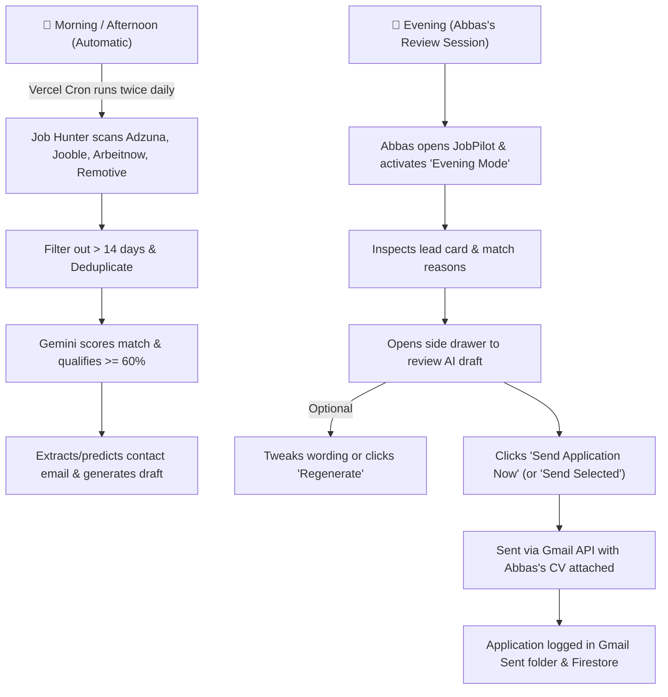

# ✈️ JobPilot – Autonomous Job Outreach System for Abbas Saifee

**JobPilot** is a production-ready, full-stack autonomous job hunting and tailored email outreach application engineered specifically for **Abbas Saifee** (`abbassaifee674@gmail.com`).

JobPilot automatically discovers relevant openings matching Abbas's verified CV (6+ years in Aviation, Industrial & General Procurement, SAP MM, Capex/Opex AED 12–15M) across high-priority target countries, uses Google Gemini Flash AI to draft personalized application pitches, and displays them on an executive dashboard. 

> [!IMPORTANT]  
> **Nothing is ever sent automatically without Abbas's click.** Every evening Abbas reviews the leads in **Evening Mode**, inspects or tweaks the AI draft, and clicks **"Send"** or **"Send Selected"**. The email is then dispatched directly through Abbas's personal Gmail account via OAuth2 with his official ATS-friendly PDF CV attached.

---

## 🏗️ Tech Stack (All Free Tiers)

- **Framework**: [Next.js](https://nextjs.org/) 14 (App Router) + TypeScript + Tailwind CSS
- **Authentication**: Firebase Authentication (Google Sign-In with strict single-user lockdown to `abbassaifee674@gmail.com`)
- **Database & Storage**: Cloud Firestore + Firebase Storage (with seed/in-memory fallback store for zero-config testing)
- **AI Engine**: Google Gemini API (Free tier, `gemini-2.0-flash` / `gemini-1.5-flash`), encapsulated in a modular provider interface (ready to swap with Groq or OpenRouter)
- **Email Sending**: Gmail API (OAuth2) with MIME multipart handling and PDF attachment (`Abbas_Saifee_Procurement_CV.pdf`)
- **Job Finding Adapters**: Adzuna API, Jooble API, Arbeitnow API, Remotive, and The Muse
- **Scheduled Automation**: Vercel Cron (`/api/cron/find-jobs` twice daily)
- **Deployment**: Zero-config Vercel hosting with GitHub repository sync

---

## 🌟 Key Features

1. **Strict Single-User Security Lockdown**:
   - Environment-driven `ALLOWED_EMAIL=abbassaifee674@gmail.com`.
   - All server routes and client auth reject any other account with HTTP 403 Forbidden.
   - Gmail refresh token is encrypted server-side with AES-256-GCM.

2. **Automated Multi-Source Job Hunter**:
   - Pulls from free legit official APIs (Adzuna, Jooble, Arbeitnow, Remotive, The Muse).
   - Normalizes every opening into a standard schema: `title, company, country, city, description, apply_url, contact_email, source, posted_date, salary`.
   - Ignores openings older than 14 days and automatically deduplicates (same company + title + country).

3. **Intelligent Match Scoring (0–100%)**:
   - Uses Gemini Flash to evaluate candidate-job alignment against Abbas's background.
   - Provides 3 punchy, verifiable reasons why the job matches, and alerts Abbas of any missing skills (e.g. local language requirements).
   - Only openings meeting or exceeding the user's minimum threshold (default 60%) are saved.

4. **Company Email Extraction**:
   - Identifies direct hiring contact emails from job listings, scans official careers/contact pages respecting `robots.txt`, and leverages Hunter.io free tier when configured.
   - Accurately labels each contact as `"Email found"`, `"Email guessed (verify)"`, or `"Apply via link only"`.

5. **AI Tailored Email Writer**:
   - Drafts 120–180 word persuasive application pitches referencing 2–3 genuine achievements from Abbas's CV.
   - Strictly forbids hallucinations, filler cliches ("I am writing to express my keen interest"), or emojis.
   - Fully editable directly in the side panel with a "Regenerate with instructions" button.

6. **Daily Send Quota & Reputation Protection**:
   - Hard cap of 40 emails/day (default 20) to keep Abbas's Gmail domain completely safe from spam flagging.
   - Bulk send action features randomized 30–90 second delays between dispatches.
   - Prevents sending the same company + role twice, and warns if the same company was emailed within the last 30 days.

7. **7-Day Follow-Up Reminder**:
   - Follow-up tab highlights leads sent 7+ days ago with no reply.
   - Includes an AI-generated concise follow-up draft sent only on Abbas's manual click.
   - Built-in reply detection scans Abbas's Gmail inbox threads.

8. **Seed / Ready Demo Mode**:
   - Pre-loaded with verified target openings for Abbas across Luxembourg, Austria, Singapore, Germany, and Australia.
   - Enables full evaluation and UI interaction before live API keys are added.

---

## 📁 Project Directory Structure

```
abbas/
├── assets/
│   └── Abbas_Saifee_Procurement_CV.pdf   # Official ATS-friendly CV
├── src/
│   ├── app/
│   │   ├── api/
│   │   │   ├── auth/gmail/               # Gmail OAuth2 URL & callback
│   │   │   ├── cron/find-jobs/           # Vercel Cron trigger
│   │   │   ├── cv/profile/               # Profile get & update
│   │   │   ├── cv/upload/                # PDF text extraction & AI parsing
│   │   │   ├── email/send/               # Single send via Gmail API
│   │   │   ├── email/bulk-send/          # Paced bulk send
│   │   │   ├── email/check-replies/      # Gmail thread inspection
│   │   │   ├── jobs/find/                # Manual "Find jobs now" trigger
│   │   │   ├── jobs/leads/               # CRUD leads
│   │   │   ├── jobs/seed/                # Reset sample leads
│   │   │   └── settings/                 # User settings get & update
│   │   ├── follow-up/page.tsx            # 7-day follow-up reminder view
│   │   ├── login/page.tsx                # Google sign-in with email check
│   │   ├── logs/page.tsx                 # Job hunter execution audit logs
│   │   ├── settings/page.tsx             # Target countries, CV upload, tone, limits
│   │   ├── layout.tsx                    # Dark theme root layout
│   │   └── page.tsx                      # Main dashboard
│   ├── components/
│   │   ├── BulkSendModal.tsx             # Bulk sender dialog with 30-90s pacing
│   │   ├── LeadCard.tsx                  # Lead card component
│   │   ├── LeadDetailDrawer.tsx          # Slide-out drawer with editable draft & CV attachment
│   │   ├── LeadTable.tsx                 # Filterable & sortable leads table
│   │   ├── Navbar.tsx                    # Header with Evening mode & Find jobs trigger
│   │   ├── SeedBanner.tsx                # Ready demo banner
│   │   └── StatsOverview.tsx             # Top 5 real-time metrics
│   ├── lib/
│   │   ├── ai/
│   │   │   ├── cv_parser.ts              # PDF parse & structured profile builder
│   │   │   ├── email_writer.ts           # Tailored cold application & follow-up writer
│   │   │   ├── gemini.ts                 # Google Gemini Flash integration
│   │   │   ├── matcher.ts                # Match scoring & reason generator
│   │   │   └── provider.ts               # Swappable AI provider interface
│   │   ├── constants/defaults.ts         # Abbas's verified profile & target countries
│   │   ├── email/
│   │   │   ├── crypto.ts                 # AES-256-GCM token encryption
│   │   │   ├── gmail.ts                  # Gmail API sender with PDF attachments
│   │   │   └── reply_detector.ts         # Thread reply checker
│   │   ├── firebase/
│   │   │   ├── admin.ts                  # Firebase Admin SDK
│   │   │   ├── client.ts                 # Firebase Client SDK
│   │   │   └── mock_store.ts             # In-memory & seed data store
│   │   ├── jobs/
│   │   │   ├── adapters/                 # Adzuna, Jooble, Arbeitnow, Remotive, The Muse
│   │   │   ├── email_finder.ts           # Website crawler & Hunter.io lookup
│   │   │   └── engine.ts                 # Job hunter orchestration & 14-day filter
│   │   └── utils/
│   │       ├── auth_guard.ts             # Single-user verification
│   │       └── rate_limiter.ts           # Daily send quota manager (max 40)
│   └── types/index.ts                    # TypeScript schemas
├── firestore.rules                       # Firestore security rules
├── vercel.json                           # Vercel Cron schedule
├── start.bat                             # One-click Windows starter
├── .env.example                          # Environment variables template
├── package.json
└── tsconfig.json
```

---

## ⚙️ Step-by-Step Setup Guide

### 1. Clone & Install Dependencies
```bash
git clone https://github.com/your-username/jobpilot.git
cd jobpilot
npm install
```

### 2. Configure Environment Variables
Copy `.env.example` to `.env.local`:
```bash
cp .env.example .env.local
```
Fill in the configuration parameters detailed below.

### 3. Setting Up Firebase (Auth & Firestore)
1. Go to [Firebase Console](https://console.firebase.google.com/) and create a project (e.g. `jobpilot-abbas`).
2. **Authentication**:
   - Enable **Google** sign-in provider in **Authentication > Sign-in method**.
3. **Firestore Database**:
   - Click **Create database** in Production mode.
   - Deploy `firestore.rules` (or paste the contents of `firestore.rules` into the Rules tab in the console).
4. **Obtain Client Keys**:
   - Go to **Project Settings > General > Your apps > Web app (</>)**.
   - Copy `apiKey`, `authDomain`, `projectId`, `storageBucket`, etc., into `NEXT_PUBLIC_FIREBASE_*`.
5. **Obtain Admin Service Account**:
   - Go to **Project Settings > Service accounts > Generate new private key**.
   - Copy `client_email` to `FIREBASE_CLIENT_EMAIL` and `private_key` to `FIREBASE_PRIVATE_KEY`.

### 4. Setting Up Gmail API (OAuth2 for Abbas)
1. In [Google Cloud Console](https://console.cloud.google.com/), select the Firebase project.
2. Go to **APIs & Services > Library** and enable **Gmail API**.
3. Go to **OAuth consent screen**:
   - User Type: **External**.
   - App name: `JobPilot`.
   - User support email: `abbassaifee674@gmail.com`.
   - **Scopes**: add `https://www.googleapis.com/auth/gmail.send`, `https://www.googleapis.com/auth/gmail.readonly`, and `userinfo.email`.
   - **Test users**: **Add `abbassaifee674@gmail.com` as a test user** (Crucial: only test users can authenticate while in Testing mode).
4. Go to **Credentials > Create Credentials > OAuth client ID**:
   - Application type: **Web application**.
   - **Authorized redirect URIs**:
     - `http://localhost:3000/api/auth/gmail/callback` (for local development)
     - `https://your-app.vercel.app/api/auth/gmail/callback` (for Vercel production)
5. Copy the Client ID and Client Secret into `GMAIL_CLIENT_ID` and `GMAIL_CLIENT_SECRET`.
6. Set `ENCRYPTION_SECRET` to any random 32-character string (used to encrypt the refresh token at rest).

### 5. Getting Free API Keys
- **Google Gemini API**: Get a free API key at [Google AI Studio](https://aistudio.google.com/). Add to `GEMINI_API_KEY`.
- **Adzuna API**: Register at [Adzuna Developer Portal](https://developer.adzuna.com/) (free). Add `ADZUNA_APP_ID` and `ADZUNA_APP_KEY`.
- **Jooble API**: Register at [Jooble API](https://jooble.org/api/about) (free). Add `JOOBLE_API_KEY`.
- **Hunter.io** (Optional): 25 free domain searches/month at [Hunter.io](https://hunter.io). Add `HUNTER_API_KEY`.

### 6. Run Locally
Double-click `start.bat` or run:
```bash
npm run dev
```
Open [http://localhost:3000](http://localhost:3000) in your browser.

---

## 🚀 Deploying to Vercel

1. Push your repository to GitHub.
2. Go to [Vercel](https://vercel.com/) and click **Add New > Project**, then import the repository.
3. In **Environment Variables**, paste all values from your `.env.local`:
   - `ALLOWED_EMAIL=abbassaifee674@gmail.com`
   - `NEXT_PUBLIC_ALLOWED_EMAIL=abbassaifee674@gmail.com`
   - `GEMINI_API_KEY=...`
   - `GMAIL_CLIENT_ID=...`
   - `GMAIL_CLIENT_SECRET=...`
   - `GMAIL_REDIRECT_URI=https://<your-vercel-domain>.vercel.app/api/auth/gmail/callback`
   - `ENCRYPTION_SECRET=...`
   - `CRON_SECRET=...`
   - Firebase keys
4. Click **Deploy**.
5. Once deployed, open `https://<your-vercel-domain>.vercel.app/settings` and click **"Connect / Re-authenticate Gmail"** to link Abbas's Gmail account in production.

---

## 📋 How Abbas Uses JobPilot Daily



### Daily Evening Checklist:
1. **Open Dashboard**: Head to the JobPilot URL.
2. **Toggle Evening Mode**: Click **"Evening Mode"** in the top bar to filter exclusively for today's new, unreviewed openings.
3. **Review Lead Cards**: Notice the match score (e.g. 96%), company, country, and the 3 concise reasons why it matches your verified experience.
4. **Inspect Draft**: Click any lead to open the side drawer. Check the personalized 120–180 word email draft and verify that the CV PDF is attached.
5. **One-Click Send**: Click **"Send Application Now"**. The email is delivered to the employer from your real address `abbassaifee674@gmail.com` and automatically saved in your Gmail Sent folder!
6. **Check Follow-ups**: Once a week, open the **"Follow-ups"** tab to check if any applications sent 7+ days ago have received replies. Click **"Check Replies Now"** or dispatch a follow-up note with one click.

---

## 🔒 Security & Sensible Defaults

- **Single-User Lockdown**: Hardcoded authorization check guarantees only `abbassaifee674@gmail.com` can access the system.
- **Gmail Quota Safeguard**: Hard limit of 40 emails/day protects your Gmail account against algorithmic delivery throttles.
- **Randomized Dispatch Delay**: Bulk sending enforces a randomized 30–90 second pause between emails.
- **Duplication Prevention**: A company + title opening cannot be sent twice. The system warns if the company was contacted within 30 days.
- **ATS-Optimized PDF CV**: The executive PDF (`assets/Abbas_Saifee_Procurement_CV.pdf`) is attached directly via standard MIME multipart formatting.
